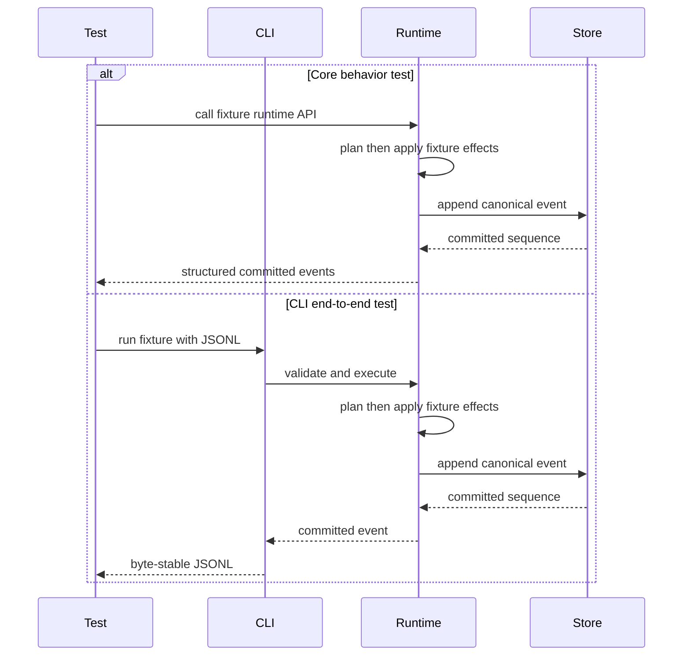

# Testing

**Flow security replacement:** Runtime, invocation policy, wire and fixtures use the [accepted replacement](SECURITY.md#flow-agent-security-contract). CI targets native Ubuntu 24.04 x86_64 and macOS 27 ARM64, including release-artifact acceptance. The [native status](#native-verification-status) records complete and partial results separately; Windows shared tests and historical feasibility observations cannot replace native proof. Manual administration, protected global/editable local instructions, overlapping locations and the full selected inventory remain required acceptance boundaries.

Verification strategy. Tests enforce product behavior and the boundaries in `SECURITY.md`; fixed workloads provide the observational evidence defined by `PERFORMANCE.md`. Definition of Done (see `AGENTS.md`) requires both where relevant.

## MVP boundary

Flow Agent MVP tests must not require Watershed-owned project-history/VCS behavior. Tests may run in a normal Git checkout, but Flow Agent does not auto-commit, branch, slice or rewrite project history in the MVP.

## Test economy

Protect meaningful functionality from every milestone, including behavior established earlier. Each test must cover a distinct function, contract, risk or regression. Prefer compact table-driven or end-to-end cases and shared setup over line-by-line tests. Do not test that an unimplemented function or absent surface remains absent. A negative test is justified only when an implemented function or branch must reject a state reachable through other implemented behavior. Coverage remains a gate, not a reason for redundant or coverage-only tests.

## Layers

- **Unit/integration per crate** — standard Rust tests run with `cargo nextest` for deterministic, process-isolated execution (no shared-state leakage between tests) and flaky-test detection.
- **Runtime storage isolation** — `cargo test` loads `.cargo/test-isolation.toml`; `cargo-nextest` receives the same runner setting inline because it owns test execution. The child runner gives each launched test executable an explicit private `FLOW_AGENT_HOME`, leaves the parent environment unchanged and removes the home afterward.
- **Deterministic FSM tests (Flow Agent)** — given a Flow plus fixed inputs and provider/Tool results, tests assert recursive leaf/composite Phase execution, whole-result handoff, `result_from`, ordered exact-typed forward Transitions and fallthrough, local and global loop bounds, Instruction rendering, available Tool sets and failure without further loop or Transition. Tests prove that a Tool reference only makes the Tool available; only a provider request invokes it.
- **Context compiler tests (Flow Agent)** — `flow-context-v0` tests assert Tier 0 section/order completeness, active-scope filtering, whole-unit recent-interaction selection/eviction, cache-prefix boundaries, budget/estimator behavior, fail-before-provider errors and canonical context hashes/manifests. M1.1 fixtures cover bounded tagged root input, complete Phase-result handoff, typed Instruction parameters, provider-requested Tool parameters, context provenance and replay. Projections, mappings and artifact routing remain deterministic absence. Tool-result fixtures prove aggregate envelope sizing spills valid streams before the complete value exceeds 64 KiB. Tests also prove older sources remain in durable history while omitted from provider context.
- **Golden flows** — recorded end-to-end flows replayed against stub-model/tool responses; event streams and output artifacts are byte-stable and diffed.
- **Event, persistence and recovery tests (Flow Agent)** — exercise every reachable commit boundary and failure class in the canonical lifecycle and storage contracts in `PROTOCOL.md`. Tests prove ordered durable prefixes, fail-closed divergence, at-most-once external dispatch, lease exclusivity and the exact functional boundaries linked from the M1.1 budget matrix.
- **Process-death matrix (Flow Agent)** — `src/tests/session/crash_matrix.rs` captures the store image before each traced durable step (create, rename, unlink, mkdir, link, write, append; a sync changes nothing a dying process loses) of a productive root Run, every step, and of a chain of twelve Runs, sampled, then runs exact and one-id Resume on each image against the recovery invariants in `PROTOCOL.md`. Unsynced-data loss and torn writes are not modelled ([D-093](docs/decisions/open-decisions.html#d-093)), nor Tool steps, which need a real Executor, nor liveness after a creation crash, since a copied image changes the inodes identity markers bind.
- **Script/schema tests** — valid building-block scripts parse into the expected model; invalid scripts fail with useful diagnostics; scoped-registry tests cover transitive references, shared-definition deduplication, unrelated-block exclusion and closure limits. Raw `flow-run-input-v0` fixtures reject duplicate object members before materialization and enforce the parser-recursion boundary separately from the semantic value-depth limit.
- **M1.1 authoring tests** — prove the complete public grammar and crash-safe transaction behavior canonical in `PROTOCOL.md`, including every selected exact/one-beyond boundary in the budget matrix.
- **Global Flow configuration tests** — assert that `FLOW_AGENT_HOME` is the sole implicit technical authority; ambient Workspace config and registries are never probed, merged or fallback sources; project-specific behavior resolves through an explicit Flow; and global authoring plus missing, invalid, inaccessible, unsafe or conflicting state fail before mutation. Separate instruction-loader tests prove ordered global-home and harness-start Workspace `AGENTS.md` discovery and prove their content cannot alter technical authority.
- **M1.1 provider/auth tests** — cover the canonical wire, credential lifecycle, parser and deadline state machines, durable attempt outcomes and redaction rules. Exact functional limits and fixtures are owned by the M1.1 budget matrix; isolation claims are owned by `SECURITY.md`.
- **M1.1 conversation tests** — cover identity pairing, branching, replay, Resume, reconciliation, status and recovery through reachable success, corruption and crash boundaries. Exact storage, scan and evidence fixtures are owned by the M1.1 limits matrix.
- **Portable continuation tests (planned)** — after D-058/D-062 decide the contract, translate every canonical archive, authority, branch-union, destination-rebinding, uncertainty and recovery acceptance row in `PROTOCOL.md`, `SECURITY.md` and those decisions into exact/one-beyond, tamper, forbidden-authority-field, repeated-import and reachable crash-boundary fixtures. Assert the resulting canonical Conversation tree and child Run, not a duplicate test-owned schema. Direct private-store copying is never a passing path.
- **Offline approval tests (planned)** — only if D-060 enables destination-local offline grants, prove their actor/device/resource/action scope, expiry, one-use behavior, audit and reconnect reconciliation. Baseline D-058 portability transfers no approval and does not wait for D-060.
- **Offline-after-provisioning tests (planned)** — after D-059/D-061 define the supported bundle and local inference process boundary, bind credential references to the selected provider/endpoint audience and reject mismatches before secret resolution. With network interfaces disabled and no remote auth, licensing, telemetry or update dependency, first run a productive local Flow; after M2, start and observe it through the same-host Meta-Harness control path; after M3, perform Liquid local reads and permissioned mutations in the same provisioned stack. Requested remote-only actions fail explicitly; sync reports offline/stale and waits resumably without blocking those local paths. Record selected model/runtime provenance and resource-admission evidence rather than claiming quality parity from model size.
- **M1 policy-emulation tests (SECURITY)** — exercise the finite decision matrix in `SECURITY.md` without claiming OS isolation.
- **Tool lifecycle tests (SECURITY)** — use real supported-target processes and controlled clocks to prove bounded launch, output, termination, cancellation and cleanup behavior. Platform guarantees and exclusions remain canonical in `SECURITY.md`; numeric limits remain canonical in the M1.1 budget matrix.
- **M1.2 Executor and native self-protection tests** — wire/framing conformance is platform-independent; fake-companion and real-process tests require their supported native target. The integrated `native_contract` and `native_self_protection` suites replace the old `official_linux` broad-isolation matrix, with native installation and release-artifact acceptance on Ubuntu 24.04 x86_64 and macOS 27 ARM64. Test the retained lifecycle and direct-write invariants, ordinary host/network access and explicit failure without fallback. A test definition or passing mock does not prove the backend; no result certifies a Custom Executor.
- **Control-plane tests (Meta-Harness)** — Meta-Harness runs headlessly without Liquid; its CLI/API/service exposes the session registry and event/transcript streams; at least two host-local agents share one normalized session/event model; cross-host process-control attempts are rejected; shared config resolves without duplicate per-agent config directories. Clients exercise the same public API over the local or authenticated remote connection, not a duplicate backend.
- **Config-write audit tests (Meta-Harness)** — every configuration change yields an audit entry; sensitive configuration changes block on approval.
- **Workspace history & agent-edit tests (Liquid)** — action-history, revert and Restore version behavior (ADR-0235); Page/Block mutation schema; Block View and typed Connection behavior; external-agent CLI/API mutation; permission denial; actor/origin attribution; workspace event subscription; and a no-hidden-writes test proving every UI/CLI/API/Liquid-AI/external-agent/sync write passes through the mutation pipeline and records an action. Liquid's workspace history is a workspace VCS over its own data, not a project-code VCS.
- **Key-management tests (Liquid, planned M3)** — device approval, recovery through a recovery key held by the person or their company, area-key rotation and device or agent revocation, each through its reachable crash boundaries, never losing access to existing data (ADR-0228).
- **Safety-envelope boundary tests (Flow Agent)** — functional tests exercise both sides of every applicable limit in the canonical [safety envelope](PERFORMANCE.md#safety-envelope), plus rotation without record splitting, immutable-object hash/deduplication/missing-object rejection, zero-byte object count enforcement before excess-entry open/retention and absence of any superseded aggregate stream cap.
- **Performance evidence** — fixed workloads follow [PERFORMANCE.md](PERFORMANCE.md). M1.1 retains its fixed `ubuntu-24.04` x64 host; M1.2 lifecycle evidence migrates to both native targets. Keep every workload definition; evidence files keep only the latest comparable record per workload, plus the record before a workload change, as [PERFORMANCE.md](PERFORMANCE.md#evidence-convention) defines. Both suites run optimized and serially, with a fresh child for each warmup/sample. CI retains their complete JSONL artifacts under the names in [CI](.github/workflows/ci.yml). Invalid workload, lifecycle, schema, measurement, report or missing artifact fails collection; timing, throughput and RSS remain observations reviewed as a KPI.
- **Coverage gate** — from M1, line coverage targets **90%**, with an **88% minimum** enforced by the canonical steps in [CI](.github/workflows/ci.yml); merge blocks below 88%. The target band is 88–92%; coverage above 92% is valid. This approved policy applies to every previous 90% test-coverage floor. Independent same-platform checks still require a drop of at most 2 percentage points and retention of at least 98% of baseline coverage. Exclusions stay unchanged. Flow Agent changes measure the workspace; Liquid and Meta-Harness changes apply the same minimum to `meta-harness-core`, `liquid_bridge`, `liquid-core` and `liquid-storage` alone; Liquid's Dart line coverage (`flutter test --coverage` in `liquid/app`) has the same minimum, excluding generated code (`lib/src/rust/`, `*.g.dart`) and the FFI-backed session glue `lib/src/session/backend.dart`. The workspace measurement on native Ubuntu and macOS must include the workspace suite, both installation paths, Custom selection/reset and applicable readiness negatives. Release binaries receive native acceptance separately; instrumented builds are health-checked before collecting coverage. Generated/FFI/CLI-arg-glue and evidence-only code may be excluded so coverage measures meaningful logic; region/function coverage remain secondary signals. Migration preserves this approved gate and every still-required behavior test; percentages never justify pruning.

Milestone pass/fail criteria and DoD are canonical in [`PLAN.md`](PLAN.md).

## Fixture contract

Checked registry fixtures follow the [Flow Agent V-Spec](docs/concept/V-Spec_FlowAgent.html); expected JSONL follows [`PROTOCOL.md`](PROTOCOL.md), with fixed fixture identities and timestamps for byte stability. Tests assert source-definition contracts separately from public event payloads.

- `smoke-flow`: the checked-in stream uses this event-type order: `session.started`, `flow.started`, `phase.entered`, `message.delta`, `message.completed`, `tool.started`, `tool.completed`, `message.delta`, `message.completed`, `phase.completed`, `flow.completed`, `session.completed`. Payloads identify one Phase, one Instruction and one predefined-command Tool; they contain no filesystem/network containment claim.
- `hello-flow`: retains that session/Flow lifecycle shape, multiple Phase enter/complete pairs, at least two Tool runs covering predefined-command and own-script `tool_kind`, an allowed-parameter case, `tool.progress`, Phase-scoped Instructions and one subflow definition reused at least twice. Each subflow invocation has a distinct runtime `flow_id`, the same payload `flow_definition_id` and `parent_flow_id` set to its containing invocation. Removed mount/profile/network/capacity fields are not public Tool payloads.
- Sandbox-negative fixtures: retain the finite `agent-negative` failure workloads for write, network/DNS, unconfigured environment, out-of-phase Tool, link traversal and interpreter scenarios. These are deterministic fixture semantics and failure-lifecycle regressions, not productive OS guarantees. Each expected stream rejects modeled effects and closes the entered Phase/Flow/session with failure; an attempted fixture Tool also has `tool.failed`. No successful terminal events follow. Closed-schema rejection tests cover removed isolation fields before real effects; they must not silently accept old security requirements.

## M1.2 transition and Executor evidence

### Native verification status

macOS support is 27 ARM64 only. CI uses GitHub's preview `xcode-27` ARM64 label: the [tested image](https://github.com/actions/runner-images/releases/tag/xcode-27-arm64%2F20260928.0222) runs macOS 27.0, build `26A428`. Older images under that label ran 26; the early native-host check rejects other releases or architectures.

The complete [push workflow, run 36908028880](https://github.com/Open-Equilibrium/watershed/actions/runs/36908028880), tested [`2b59f10`](https://github.com/Open-Equilibrium/watershed/commit/2b59f10209dbc5e6a7f81c7bab5a6e6d1bdbe413), tree `e0a51276c57a3da2750568f0751069ddfd49dcb4`, the last commit of [PR #7](https://github.com/Open-Equilibrium/watershed/pull/7) before it was squashed into `51718971` on `main`, whose tree differs. Both native jobs succeeded. This proves that tree; subsequent changes, remaining closeout gates and public release are unverified.

| Target / job | Established result |
|---|---|
| Ubuntu 24.04 x86_64, [job 110523397292](https://github.com/Open-Equilibrium/watershed/actions/runs/36908028880/job/110523397292) | Regular and instrumented suites each pass 1,201/1,201 tests; release Executor passes 16/16; none skipped, nextest exits 0. Line coverage 90.49%, report exit 0. |
| macOS 27 ARM64, [job 110523397025](https://github.com/Open-Equilibrium/watershed/actions/runs/36908028880/job/110523397025) | Regular and instrumented suites each pass 1,197/1,197 tests; release Executor passes 17/17; none skipped, nextest exits 0. Line coverage 90.50%, report exit 0. |

Both native jobs pass downloaded-archive hash verification and extraction with OS tools, standard/Custom installation and reset, applicable readiness negatives, performance collection and the remaining CI gates.

Mac records synthetic quarantine on the archive and all three extracted files before the additional extracted-file control. Source and installed signatures verify (exit 0), and installed bytes match. Gatekeeper policy is enabled (status exit 0) but rejects source and installed programs (assessment exit 3); byte-copy installation does not preserve quarantine metadata. This run provides no evidence of natural browser transport, Developer ID signing, notarization or Gatekeeper approval.

The old systemd/container gate and its broad-isolation assertions no longer define release acceptance. Native tests must run on Ubuntu 24.04 x86_64 and macOS 27 ARM64. Record actual command exits, runner identity and tested artifact; source inspection, cross-builds and Windows shared tests cannot fill missing native evidence.

Finite regression boundaries:

- **Executor launch:** ADR-0176 accepts checked native-path launch on Mac and the same public guarantees on Linux; [PROTOCOL.md](PROTOCOL.md#process-and-framing-contract) owns the checks. Verify both Executor starts and detected replacement rejection natively. Linux's retained-image regression remains an implementation check, not an additional product promise.
- **Spawn error-channel collision:** the isolated `protected_descriptor_remapping_preserves_spawn_failure` regression occupies descriptors 0–21 before launch, so Rust's exec-status writer could land on a protected destination; [Rust treats status-pipe EOF as successful execution](https://github.com/rust-lang/rust/blob/48a229ceaefd4985c50990b14116b6d856af0985/library/std/src/sys/process/unix/unix.rs#L139). Remapping reserves free destination slots and retains existing objects: the child accepts unchanged inherited pipes/sockets but rejects newly introduced channels, including slots concurrently freed by a parent thread. The regression asserts the actual permission error, unchanged parent descriptors and valid protocol traffic on both native targets.
- **Probe and descriptor lifecycle:** the isolated inherited-socket control must allow valid protocol traffic without weakening spawn-error detection. The failed-probe control must release its own output descriptors even if a detached fixture child retains the opposite pipe ends; this does not promise hostile-descendant termination.
- **Ready/Start fixtures:** shell programs sent through the same input pipe as Start must parse their complete command group before reading Start. Deadline/cancellation fixtures group the script, reject input closure before Start and assert no early effect.
- **Installation:** the receipt assertion requires the canonical 64 lowercase hexadecimal characters, preserving the separate prefixed request hash. A missing process scanner causes immediate cleanup escalation instead of futile polling. Installer unit tests do not replace installed-product proof.
- **Coverage preparation:** select artifacts through the target directory exported by `cargo llvm-cov show-env`. Load that environment **before** workspace cleanup, as required by the tool's [external-test instructions](https://github.com/taiki-e/cargo-llvm-cov/blob/v0.9.1/README.md#get-coverage-of-external-tests); otherwise cleanup targets `llvm-cov-target` while external builds use the ordinary target. The [CI contract tests](tests/test_ci_toolchain_contract.py) guard this ordering.

Repository review and closeout status is canonical in [PLAN.md](PLAN.md#m12--flow-agent-os-isolation). No partial review or passing stage establishes completion.

### Authorized Mac feasibility evaluation

The dev-only probes below are bounded feasibility workloads on macOS ARM64, not the integrated production Executor. Their macOS 26 observations, which informed ADR-0172, live in Git history and their CI runs. Keep these workloads and controls when validating the replacement, but report product evidence in the [native status](#native-verification-status).

The dev-only [App Sandbox comparison](scripts/probe-macos-app-sandbox.py) runs with `python3 scripts/probe-macos-app-sandbox.py` on macOS ARM64. It compares the same synthetic native helper without protection, under the checked profile, under minimal App Sandbox, with an App Sandbox temporary absolute-path read/write exception for one synthetic project directory, and with that exception plus executable-write permission. The user-selected entitlement alone grants no selected directory; the exception is explicitly **not** a test of file-panel grants/bookmarks. Helpers use documented inheritance entitlements and local ad-hoc signatures, never a release identity. The probe compiles with the existing Xcode toolchain and installs nothing. Its unique home-directory fixtures are removed; OS-created synthetic app containers disappear with the disposable hosted runner. Exit 0 means the observation matrix completed, not that all mechanisms met the product requirements; exit 2 means incomplete measurement or setup failure. Command exits and observed mutations remain explicit. The opt-in CI experiment runs it even after the retained raw-profile counterexample fails. Windows classification tests are not sandbox evidence.

The npm extension adds three offline `npm run build` lifecycles to every comparison configuration: a dependency-free JavaScript build that executes generated JavaScript in a Node child, a native compile/run through `xcrun`, and a native compile/run with directly resolved compiler/SDK/linker paths. Each requires real prebuild/build/postbuild execution and verified output bytes, not merely exit 0; each unprotected control must also prove that its deliberate synthetic protected-file write was allowed. Existing Node/npm are required and their versions/paths are recorded. Empty explicit user/global npm configuration and private caches prevent use of operator npm settings; no dependencies are downloaded or installed. The fixture selects its package through `--prefix`, independently of the initial working directory. Successful builds also attempt a synthetic protected-file write and report its outcome. A sixth configuration adds read-only access to the existing Node installation/npm package while retaining project and executable-write entitlements; no runtime is copied, re-signed or installed. This is not React/Vite/Next.js, package-install, Python or actual Codex CLI binary coverage. The portable fixture/classifier and entitlement tests verify experimental setup, not Mac protection.

The dev-only [native probe](scripts/probe-macos-self-protection.py) exercises disposable synthetic files on macOS ARM64; it neither changes nor enables the product Executor. Run `python3 scripts/probe-macos-self-protection.py --mode baseline` first: exit 1 is the required unprotected red control, not a passing guard. Then run the same assertions with `--mode profile`: exit 0 means only those native cases passed; exit 1 records a protection violation, and setup/launch failures are errors, never successful denial. The simple path-only profile is a retained counterexample: pre-existing hardlink aliases, inherited writable handles and ancestor relocation still change the protected fixture, so it exits 1. Existing `sandbox-exec` and Python are required; the probe installs nothing.

The matrix distinguishes existing aliases from Tool-created hardlinks and relocation of a protected directory's parent. Its writable-handle case deliberately passes an already-open fixture descriptor: this tests the profile alone, not whether Flow leaks such descriptors. A complete launch boundary must also prove descriptor sanitization; an allowed inherited handle is not evidence that the production Executor forwards it. No observed case selects new installation restrictions.

The separate `--mode guarded-launch` experiment adds ancestor-unlink denial, closes the deliberately opened fixture descriptor at launch and rejects a fixture with an existing hardlink before launching a helper. It tests the same operations and labels readiness rejection and closed handles separately from OS denials. ADR-0169 now accepts the alias/ancestor restrictions; the fixture check is not a production protected-object scanner or approval of every launch condition. CI retains both profile and launcher results and fails if either reports a violation or setup error.

`--mode host-build` compares an unprotected and guarded `/bin/sh` workload using existing Xcode command-line tools: compile a small ARM64 C writer, verify its local code signature, write a project fixture and attempt a protected-file write. The guarded build must succeed while its protected write returns permission denial; the unprotected writer must change both fixtures. Each workload has a 30-second deadlock guard and a 4 MiB per-file cap for its generated binary/log; neither is a product performance requirement. No compiler, signing identity or certificate is installed or acquired. A local signature check is not Developer ID/notarization or release-provenance evidence.

The `lifecycle-baseline` and `lifecycle` modes exercise the same synthetic multi-root layout without and with protection: two homes, an outside-home platform store, installed/custom image names, internal publication aliases, metadata changes, a new-session child, current/later review-terminal handles and trusted-parent append/rename/hardlink publication after the child starts. A separate child writes only after its Tool parent has exited. Parameter-bound paths include quotes, a backslash, Unicode and a newline; paths are data, not profile source. Each mode exits 0 only when all its expected allowed/denied outcomes hold. The baseline must actually permit the dangerous operations; a setup error is never successful denial. The dev-only inventory counts all covered names of each inode and rejects external hardlinks, unsupported objects and incomplete/over-budget scans; it is not a race-safe production scanner. No real credentials, Flow homes or installed binaries are inspected. [SECURITY.md](SECURITY.md#native-self-protection-and-its-limits) owns the invariant; the [replacement acceptance matrix](#replacement-acceptance-matrix) owns release acceptance.

CI can run this experiment on the selected branch with `gh workflow run ci.yml --ref <topic-branch> -f mac_self_protection_evaluation=true`; every normal gate remains enabled. Retain the exact source revision and per-mode exit codes. These bounded cases do not prove general build-system compatibility, Metal workloads, supported Apple API stability, signed distribution or cross-installation protection. ADR-0172 selects the Seatbelt mechanism, not release readiness; full native product acceptance remains mandatory even if the probe passes. Instruction protection must distinguish editable Workspace-local `AGENTS.md` from the protected global file under corrected ADR-0171.

### Replacement acceptance matrix

The following are required outcomes, not a claim that their complete native run has passed.

- **Continuous testability and conformance:** Fixture tests remain runnable without a Default Executor. Preserve closed-schema, duplicate-member, version/framing, malformed/oversized/unexpected output, request-id, stderr-redaction and independent preflight/Start/terminal-deadline cases. Prove that the same retained process flushes `Ready`, that `tool.started` commits before `Start`, and that EOF, absent/malformed/mismatched `Start`, cancellation or commit failure before `Start` creates no Tool. After dispatch, missing, invalid or late evidence remains uncertain.
- **Native boundary:** [native_contract](flow-agent/flow-agent-executor/tests/native_contract.rs) exercises own-object/child writes, deletion/replacement, symlink/new-hardlink paths, ancestry, global/local instructions, descriptor/identity replacement before launch, terminal denial, host runtimes, networking, explicit environment, npm lifecycle and bounded terminal outcomes. [native_self_protection](flow-agent/flow-agent-executor/tests/native_self_protection.rs) exercises the real one-shot protocol and protected-file/project controls. Run both against native release artifacts as well as the ordinary test builds; inspect actual outcomes before claiming coverage complete.
- **Admission and publication:** verify selected home, platform stores, `flow`, selected Executor and any existing official sibling. Only explicit Custom selection permits a genuinely absent sibling; unsafe existing siblings reject. Exercise no-follow discovery, outside aliases, internal publication aliases, overlapping roots counted once, unsupported/incomplete inventories, replaced identities, publication leases, and concurrent/interrupted create, append, hardlink, staged-file replacement and staged-directory rename. Inventory is once per prepared controller, not a retained-history rescan per Tool. Warned overlap never bypasses failed admission.
- **Inherited authority and lifetime:** preserve writable-handle removal, protected descriptor/image handling, metadata and mapped writes, new-session children, parent exit and current/later terminal-device cases. A surviving child must retain protection. Bounded root termination, cancellation and output collection must report what was observed; no test may equate a root exit or timeout with proof that every hostile descendant stopped.
- **Host compatibility controls:** retain ordinary project reads/writes and hardlinks, shell/C compilation and execution, direct Xcode compiler and `xcrun` paths, and offline npm `prebuild`/`build`/`postbuild` workloads that generate/run JavaScript or native children and verify outputs. Add real Python execution and available host-network/local-service controls from `native_contract`. Historical raw-profile, guarded-launch and App Sandbox comparisons retain their original expectations. A denied protected write counts only after the intended workload launches; setup failure is never successful denial. These finite workloads do not certify all build systems, GUI/Metal access or every interactive application.
- **Invocation and environment:** preserve parameter/type/argv bounds, interpreter and environment regressions as checks of admitted invocation and enforcement-launch integrity. Trusted programs still own their later path/action/dependency behavior. Environment values reach only the Tool inside the established boundary; ambient values and Flow-owned credentials are not forwarded. Write protection makes no credential-read-isolation claim.
- **Receipt and recovery:** canonical digest binds the complete `resolved_policy` plus final LF, including limits and protected descriptor/path/identity records. Require matching identity/platform/digest and `self_protection_active: true`, then persist the receipt with the terminal attempt. Preserve preflight-rejection replay, pre-Start cancellation with exact `flow-attempt-cancelled-v0`, recovery-record reconstruction, and post-Start uncertain-attempt binding without redispatch. Never infer rollback.
- **Output and failure:** preserve normal/nonzero/signal exits, exact and one-beyond output caps, simultaneous cap precedence, cancellation/deadline races, collector errors, drain deadlines, malformed terminal states and truthful durable closure. General network denial, runtime-read-profile equivalence, cgroup/PIDs ceilings and empty-leaf/absolute hostile-descendant cleanup are removed guarantees; do not retain them as passing criteria for this replacement.
- **Installation and readiness:** on each native target, exercise standard and `--no-default-executor` installations, empty `PATH`, arbitrary initial directory, create-only/unsafe-prefix rejection and cleanup limited to the attempt's own files. The explicit privileged CI fixture uses a non-root `SUDO_USER`, real sudo/setpriv and observed process groups/terminals to verify readiness, cancellation and rollback. Test release artifacts separately from instrumented binaries. Authoring/validation/Fixture execution remains possible without the Default Executor; productive Tool dispatch fails before Run reservation/provider contact until an admissible selection is ready. Exercise Custom configure/reset and missing/unsafe/replaced programs. Applicable mechanism failures (Linux user namespaces/seccomp/Bubblewrap; Mac Seatbelt) reject without weaker fallback. Systemd/cgroup prerequisites and automatic host reconfiguration are not part of the replacement.
- **Distribution and support:** release-mode artifact acceptance is not final downloaded-bundle proof. Retain checksum/target/HTTPS rejection, native clean installation and applicable Mac quarantine/signing/notarization acceptance under [SECURITY.md](SECURITY.md). No Custom conformance/probe result certifies third-party enforcement. Broader OS ranges and external nested sandboxes require separate evidence under [PLATFORMS.md](PLATFORMS.md).

## Liquid MVP pass/fail (M3)

In addition to the staged M3 DoD in `PLAN.md`, Liquid must prove: deterministic first-action Block creation; flow and Arrange mode preserve canonical View order; synchronized Views share Block state while duplicate creates a new Block; last-View deletion follows the decided Connection/Automation cascade and is recoverable through History; layout never grants Connection or permission access; allow-only Roles deny unlisted Liquid actions and discovery/read requests even though an authorized device's full plaintext replica may contain those resources; mobile retains every Block with focused editing for complex Views; App code and MCP adapters cannot exceed declared capabilities; every write surface records an Action; external-agent changes can be reverted; replicas converge through the central Sync Server; headless replicas receive only opted-in Workspaces; replicated resources keep stable identities, changes remain resource-addressed and incompatible sync versions fail closed; ADR-0235 history and recovery and the ADR-0238 merge behavior work; and the [client architecture](docs/concept/liquid-client-architecture.md) rules hold: editing one Block rebuilds and repaints no other Block, Pages build only viewport Views, bridge payloads stay bounded, killing the app after acknowledgement or during sync loses no acknowledged change, reconnection never resets local state to a remote snapshot or drops unsynced local changes outside the CRDT merge, Database Views read bounded pages and closing a View releases its subscriptions. Selective authorized-resource replication is not an MVP gate and requires a later finite closure contract before implementation.

## AgentPulse as a quality gate

The same metrics AgentPulse reports (rework ratio, first-attempt success rate, cost-per-productive-outcome) are tracked in CI on golden flows once their formulas are decided in [D-010](docs/decisions/open-decisions.html#d-010).

## Development toolchain

Node is a dev/CI-only toolchain for documentation gates (HTML rendering and link-manifest generation), the Node advisory audit, the runtime package review gate, the Rust test-isolation runner, the cross-platform Python launcher and the pi extension's tests. `package.json#engines.node` defines the supported Node range; [`.node-version`](.node-version) pins the reproducible development/CI version and `package.json#packageManager` pins pnpm. Ubuntu CI additionally exercises the repository tooling and HTML rendering at the declared Node minimum after the pinned gates. Watershed ships no Node runtime; Meta-Harness runs the user's own pi, whose Node also runs Watershed's pi extension (ADR-0001).

Repository tooling requires Python 3.11 or newer for its standard-library TOML parser. The launcher verifies this before running a script and reports missing prerequisites without installing them.

Liquid clients use Flutter, which builds desktop apps only on their own operating system. Each Liquid target in [PLATFORMS.md](PLATFORMS.md) needs:

| Target | Build host | Toolchain |
|---|---|---|
| macOS | macOS | Xcode; installing it requires a free Apple ID. Command Line Tools alone lack `xcodebuild`, `actool` and `ibtool`. |
| Windows | Windows | Visual Studio with the "Desktop development with C++" workload |
| Linux | Linux | clang, CMake, Ninja, pkg-config and GTK 3 development headers |
| Android | Linux, macOS or Windows | Android SDK |

`liquid-storage` compiles SQLCipher and OpenSSL from source (ADR-0237), so every host that builds it also needs Perl and make; Windows uses Visual Studio's nmake instead of make. CI hosts have no keychain, so the bridge's keychain test is ignored; run `cargo test -p liquid_bridge -- --ignored keychain` by hand on each desktop target whenever how the key is stored changes.

Every Liquid build, including `flutter test`, also compiles the Rust bridge in a Dart build hook through native_toolchain_rust, not cargokit and CocoaPods, using rustup with the toolchain pinned in `liquid/liquid-bridge/rust-toolchain.toml`, which therefore deliberately repeats the root Rust pin (ADR-0213). Flutter passes hooks only a few environment variables, such as `PATH`, `HOME`, proxy settings and those starting with `CCACHE_`, `DOTNET_`, `NIX_`, `NUGET_` or `CONAN_`, and records them in `liquid/app/.dart_tool/hooks_runner` and in verbose output; keep credentials out of all of them on build hosts. flutter_rust_bridge has one main maintainer, so every Flutter or Rust pin update also checks its recent releases and open issues for whether it is still maintained (ADR-0217). Without Xcode, a Mac still runs Rust core tests, `flutter test` and `flutter analyze`. Native CI hosts can supply the other desktop builds.

## CI

- Gates run in parallel jobs per product. [The scope script](scripts/ci-product-scope.mjs) selects Flow Agent, Meta-Harness and Liquid from the paths a change touches; a Meta-Harness change also selects Liquid, which builds on it, and any other path, including every Cargo manifest, selects all three. Every selected product runs the workspace lint and advisory gates and the tests of its packages; Flow Agent adds installation, release-artifact, evidence and workspace coverage gates, and Liquid its Flutter, bridge, key helper, macOS app test and own coverage gates. Required job names remain present for every change and pass only when every job passed or was not selected. Changes limited to [repository agent setup](AGENTS.md#conventions) run no gates. Changes limited to that setup and Markdown or HTML files run only the documentation gates: repository tooling tests, HTML render and documentation links; only these gates may read Markdown or HTML files. Manual runs retain every gate; pull requests compare their complete change against the base commit. Documentation-link inputs exclude repository agent setup.
- A newer push to a topic branch or update of a pull request cancels its earlier run; every main commit keeps its own. A push whose newest commit message contains `[skip ci]` starts no run, so use it only for intermediate pushes: a pull request's newest commit must run CI, or its required checks never report. Pull request titles and bodies never contain `[skip ci]`, because the squash commit on main takes them over.
- Flow Agent CI covers the complete workspace on native Linux x86_64 and macOS ARM64. Windows CI and its required check are deferred until Liquid has an implemented Windows consumer; its planned support remains in [PLATFORMS.md](PLATFORMS.md).
- Mandatory gates and their package selections are canonical in [CI](.github/workflows/ci.yml).
- The Liquid macOS app build is a required step of the macOS Liquid job.
- A local cross-build or a Windows editor session cannot substitute for the pushed branch's native Flow Agent gates. Verify their actual CI results with `gh`.
- Block merge on any mandatory gate failure, including performance-evidence integrity and native self-protection, installation and release-artifact acceptance; observed timing, throughput or RSS values do not fail the gate.
