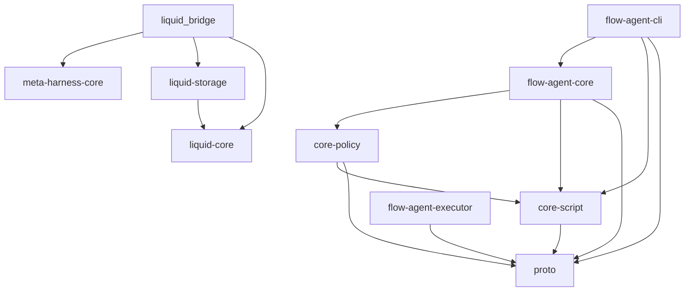
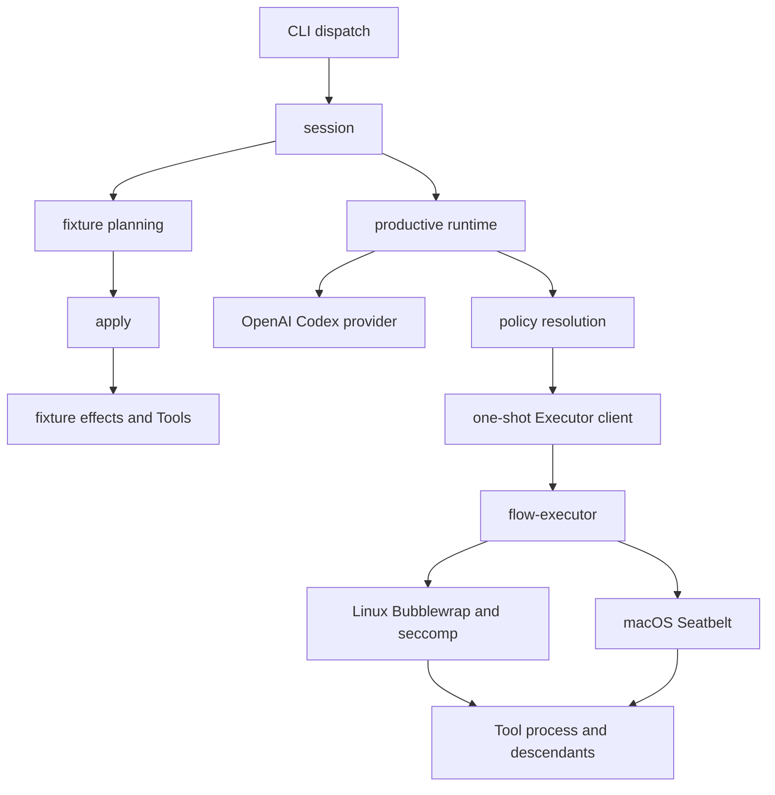
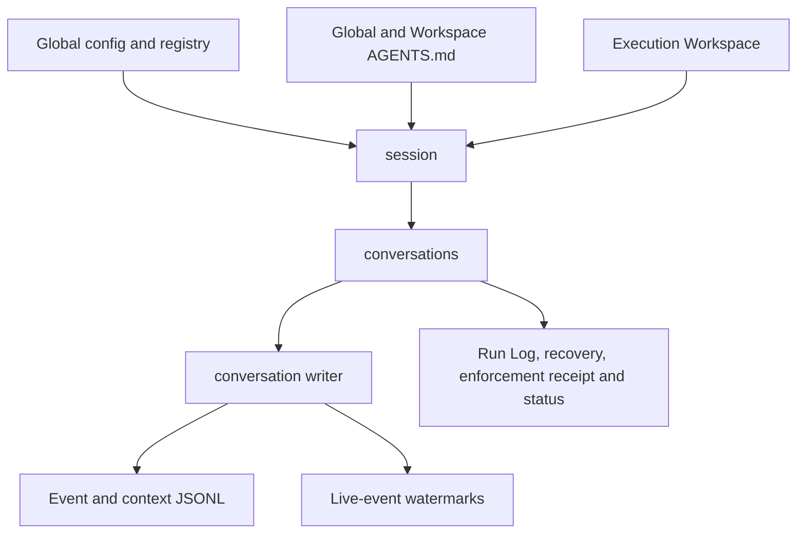

# Current implementation architecture

These diagrams map the Rust workspace and major Flow Agent responsibility paths. The [Flow Agent Executor architecture](concept/flow-agent-executor-architecture.md) explains the security boundary. Product topology is canonical in [`VISION.md`](../VISION.md); runtime behavior and storage contracts are canonical in [`PROTOCOL.md`](../PROTOCOL.md). Security and evidence remain in [`SECURITY.md`](../SECURITY.md) and [`TESTING.md`](../TESTING.md).

## Rust workspace crates

Arrows mean “depends on.” This graph includes current Cargo workspace members only.

The package manifests are the executable dependency source of truth. Test-only dependencies are omitted. `flow-agent-executor` is the companion binary launched through the protocol, not a library dependency of Flow Agent core.

## Flow Agent runtime responsibilities

These are major control/data paths, not an exhaustive Rust module dependency graph or public embedding API.

### Execution paths

The Fixture path is deterministic and in process and makes no Flow-owned write protection claim. Productive execution shares request validation, Ready/Start, supervision and result handling; native modules enforce only the selected Flow-owned write protection. This source implementation still requires native replacement acceptance. Provider-only Flows have a separate [platform boundary](../PLATFORMS.md). [SECURITY.md](../SECURITY.md) defines guarantees and trusted Tool/delegation responsibilities.

### Persistence and inputs

See the [Flow Agent V-Spec](concept/V-Spec_FlowAgent.html#architecture) for responsibility boundaries. Current module declarations live in [`flow-agent-core/src/runtime/mod.rs`](../flow-agent/flow-agent-core/src/runtime/mod.rs); CLI composition lives in [`flow-agent-cli/src/dispatch.rs`](../flow-agent/flow-agent-cli/src/dispatch.rs).

## Architecture boundaries

Flow Agent's runtime keeps these boundaries; provider and subprocess work preserves them:

- `proto` alone validates Event-envelope and Event-payload structure; the runtime keeps only stream, sequence, budget and lifecycle invariants.
- `core-script` is real Rust modules with explicit visibility and imports, no `include!` assembly and a minimal public API.
- Imports, re-exports and security-critical interfaces are targeted, not flat `pub use module::*` namespaces or systematic `use super::*`.
- Modules split by responsibility: planning and apply, Event construction and persistence, lifecycle validation, Run reservation and locks, bundle inventory, reader, replay and tail, Resume, context compilation, fixture Tool execution and capability-relative filesystem operations; tests split the same way, behavior-focused, with the coverage threshold unchanged.
- `FlowExecutionPlan` is a typed finite IR: planning has no provider or Tool adapter and performs no side effects, invocation IDs are planned, Apply consumes only the plan, Resume distinguishes pending from completed intents, and no second full FSM pass substitutes for the IR.
- `main.rs` is only the composition root; argument and usage parsing, dispatch, live streaming and tail are separate internal modules.

## Configuration boundary

Flow Agent resolves technical configuration only from the Global Flow home defined by `PROTOCOL.md`. Its `config.yaml` selects a registry only beneath that global home. Workspace `.flow` files and registries are never implicit inputs. Global-home and harness-start Workspace `AGENTS.md` files are loaded separately as ordered instructions and cannot alter technical authority. Executor selection is a separate protected administrator setting: the default derives the sibling `flow-executor`, while a Custom Executor requires an absolute override. [`PROTOCOL.md`](../PROTOCOL.md) owns both contracts.
