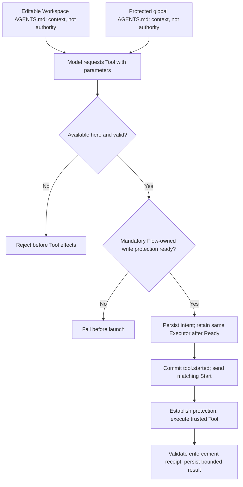
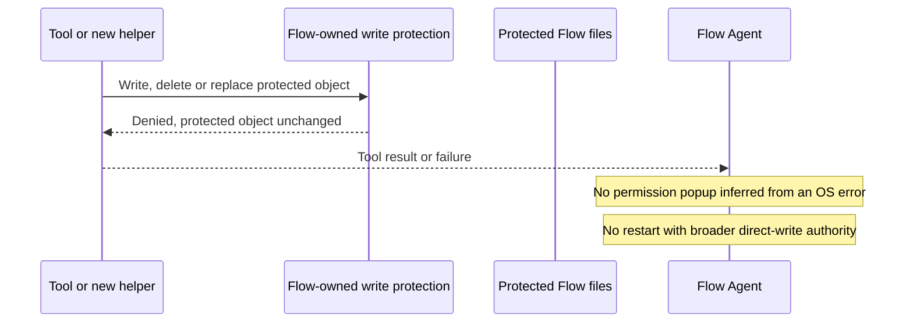
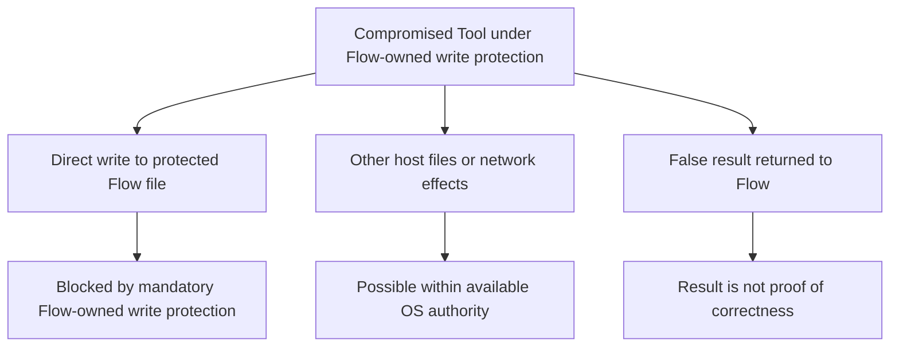
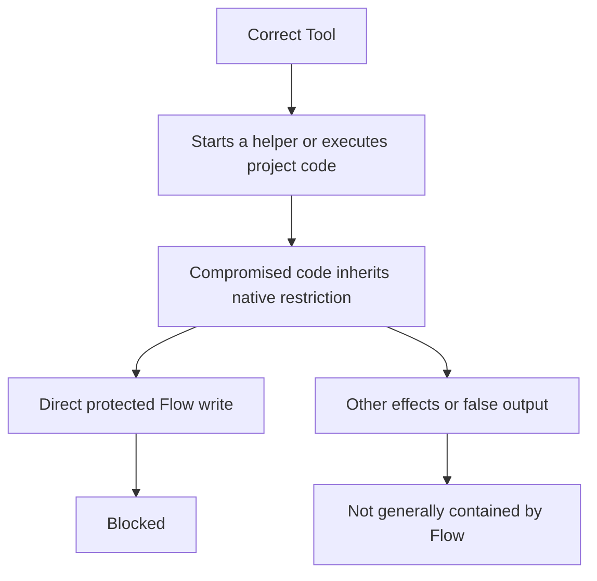
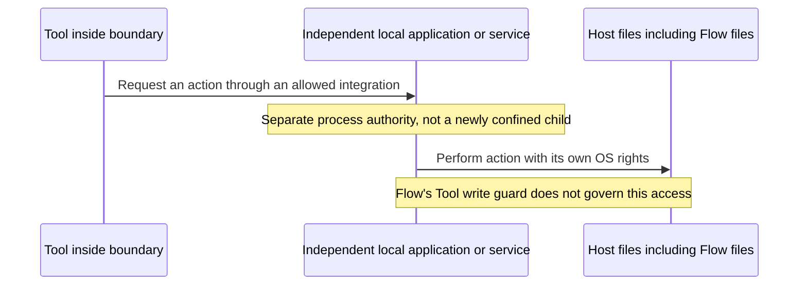
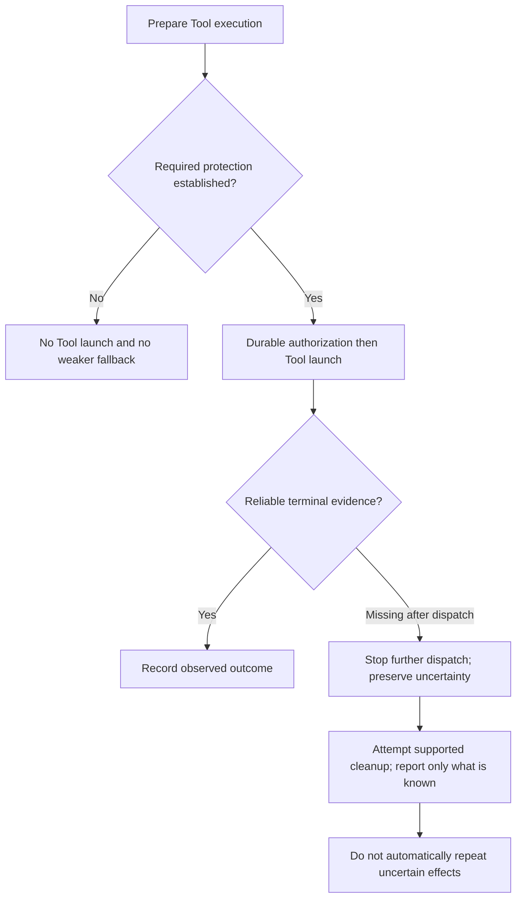
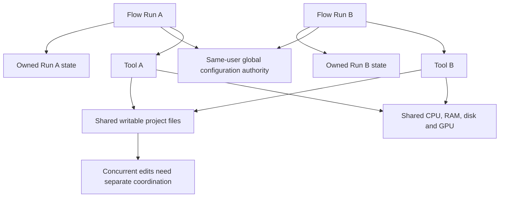
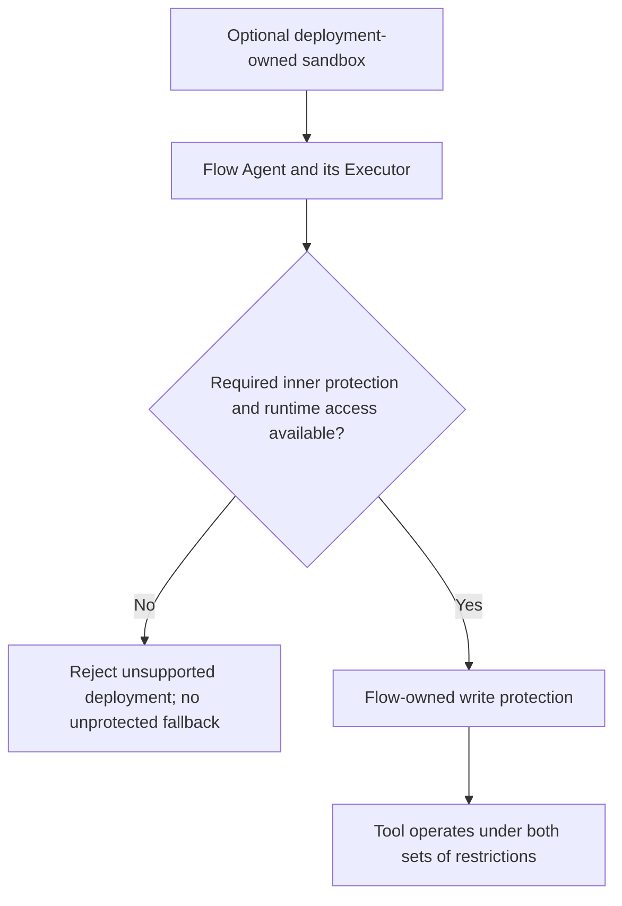
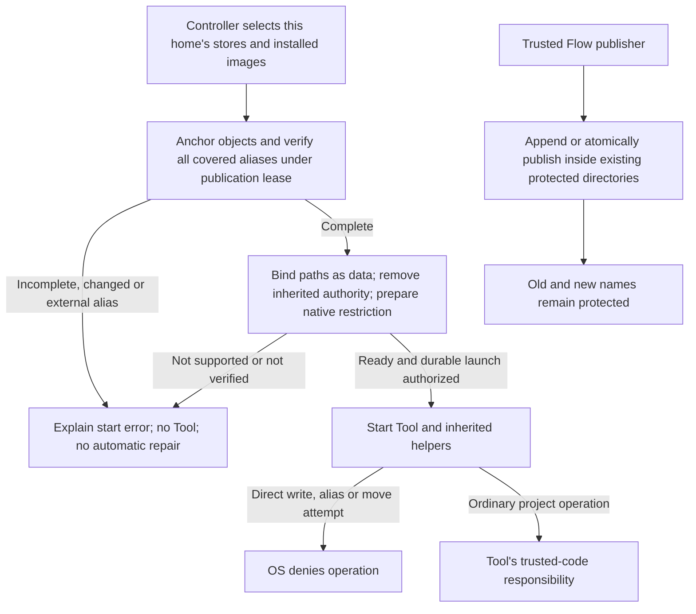

# Flow Agent execution and security architecture

Diagrams of the boundaries in the normative [security contract](../../SECURITY.md#flow-agent-security-contract), which owns guarantees and responsibilities; [PROTOCOL.md](../../PROTOCOL.md#m12-executor-protocol) owns the Executor wire and [TESTING.md](../../TESTING.md#native-verification-status) native results. The cases are representative authority paths, not an exploit enumeration.

## 1. Ordinary or invalid request

Only a valid in-scope invocation runs; instructions are context, never authority.

## 2. Direct protected write

Native denial, including children; no prompt, escalation or retry.

## 3. Compromised Tool

Direct protected writes stay blocked; other host effects and false results are not contained.

## 4. Compromised new helper

The helper inherits the restriction; the trusted-dependency assumption is nevertheless broken.

## 5. Independent third-party service

The service acts with its own authority, outside the Tool write guard.

## 6. Missing boundary or interrupted execution

No unprotected launch; post-launch uncertainty is neither success nor permission to replay.

## 7. Parallel agents

Run ownership neither serializes shared project edits nor reserves host resources.

## 8. External sandbox

Extra containment works only when the nested prerequisites do; no fallback.

## Protected-set admission and publication

One controller admission precedes Tool launches; Flow publishers stay inside protected directories.

