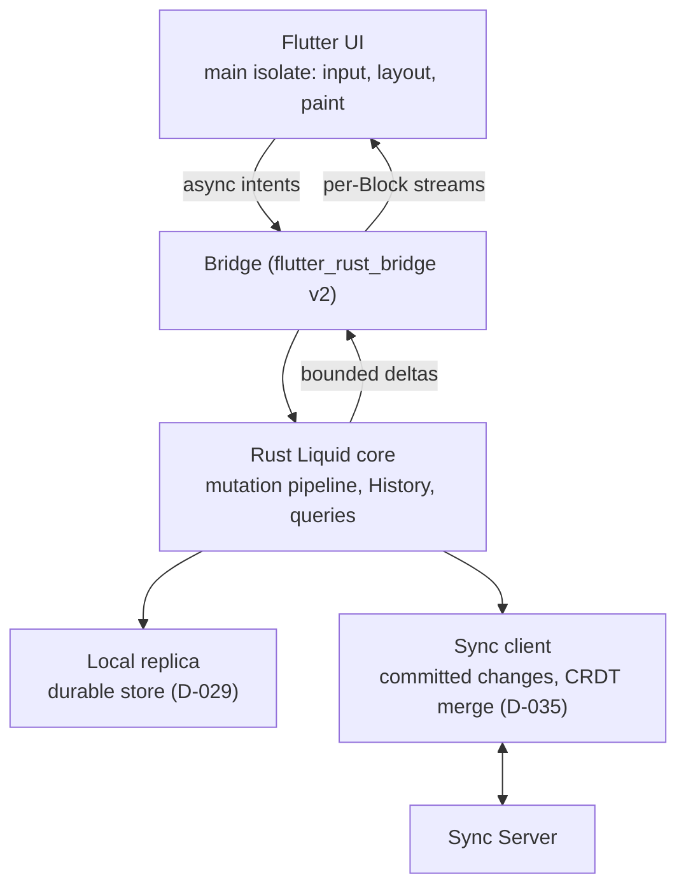

# Liquid client architecture

This document turns the accepted Liquid client stack (Flutter UI over a Rust Liquid core) and its performance and stability invariants (ADR-0181, ADR-0182) into implementation rules. Product behavior is canonical in the [Liquid V-Spec](V-Spec_Liquid.html), targets in [`PLATFORMS.md`](../../PLATFORMS.md), performance evidence in [`PERFORMANCE.md`](../../PERFORMANCE.md#liquid), security in [`SECURITY.md`](../../SECURITY.md) and pass/fail evidence in [`TESTING.md`](../../TESTING.md). The bridge is flutter_rust_bridge v2 (ADR-0186); the History model, storage engine and CRDT library remain [D-028](../decisions/open-decisions.html#d-028), [D-029](../decisions/open-decisions.html#d-029) and [D-035](../decisions/open-decisions.html#d-035).

## Priority

Input responsiveness and zero loss of acknowledged local changes take precedence over feature completeness. A feature that cannot meet the rules below ships reduced or not at all; it never weakens them.

## Layers

- Rust owns Workspace state, the mutation pipeline, History, queries, storage and sync. Dart holds only rendering state and the in-progress edit of the focused Block.
- Widgets read typed view models and emit intents. No widget writes storage or bypasses the mutation pipeline.

## Rules

### Threads and bridge

1. The Dart main isolate only handles input, layout, paint and applying bounded deltas. Storage access, queries, large (de)serialization, diffing, CRDT merge, sync and App code never run on it or on Flutter's platform or raster threads.
2. The Rust core runs on its own worker threads. Every bridge call from Dart is asynchronous; the main isolate never blocks on disk or network.
3. The bridge carries bounded deltas addressed by stable IDs and a per-resource sequence, for example `BlockDelta { block_id, seq, op }`. It never carries a whole Page tree, a whole Database or an unbounded list. Opening a View transfers one bounded snapshot of what its viewport needs.
4. Rust pushes updates as asynchronous streams and shares one producer per resource across synchronized Views. When the UI falls behind, Rust coalesces pending deltas per resource to the latest sequence instead of queueing every intermediate state; a consumer that detects a sequence gap requests a fresh bounded snapshot.

### Rendering

5. Pages build only Views that intersect the viewport plus a bounded cache extent; Arrange mode virtualizes grid rows the same way. Measured View heights persist in a device-local cache outside synced layout and History, so scroll position stays stable when off-screen Views rebuild.
6. Each Block View subscribes only to its own Block's stream and is its own repaint boundary. Editing Block A never rebuilds the Page or the Explorer and never repaints another Block; the Page subscribes only to View order and layout.
7. Text input, selection and IME composition live in the focused Block's controller and render in the next frame without awaiting the bridge; the resulting mutation crosses the pipeline asynchronously. Edit controls are enabled only where the effective permission already allows the write, and a later pipeline rejection reverts the local edit visibly.
8. Whiteboard, wide Database and complex App Views use their own tile or viewport slicing.

### Durability and sync

9. A local change is acknowledged only after the core has durably committed it, together with its History Action, to the local replica. The editor may group consecutive keystrokes into one commit; only unacknowledged input can be lost in a crash.
10. Sync sends only durably committed changes and tracks its progress in the local replica. A committed change that awaits sync is never rewritten or dropped; later edits are new changes. Network state never gates or delays the local commit.
11. Sync uses the established CRDT library selected by D-035; Liquid adds no custom conflict-resolution algorithm. Remote changes merge through that library; sync never resets local state to a remote snapshot or drops unsynced local changes outside that merge.
12. Connection loss, suspension or termination by the OS, including Android background limits, leaves committed changes and sync progress intact. When the app is paused the UI hands the focused edit to the core; on resume the sync client retries from its durable cursor.

### Resources

13. Database Views read windowed pages sized to the viewport. Sorting, filtering, grouping and aggregation run in Rust against indexes; Charts and Formulas receive computed results, not source rows.
14. Every stream subscription, native handle and Dart listener has exactly one owner, normally the View widget, and is released when that owner is disposed or its Page closes. Cancelling a Dart stream drops the corresponding Rust producer.

## Risks against the current V-Spec

- **CRDT merge versus Roles:** every replica applies received changes through its own mutation pipeline ([`SECURITY.md`](../../SECURITY.md)), so a change one replica rejects and another accepts breaks convergence. D-035 requires proof that Roles reject such a change identically on every replica.
- **CRDT history versus Liquid History:** CRDT libraries keep their own change history; D-028 decides whether Liquid History derives from it or is stored separately.
- **Variable-height virtualization:** Views whose height is unknown until built cause scroll jumps; rule 5's persisted heights are the mitigation and need observational evidence.
